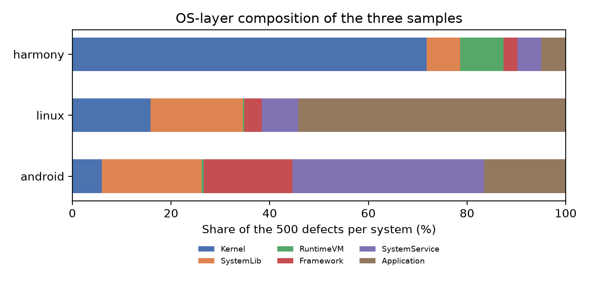
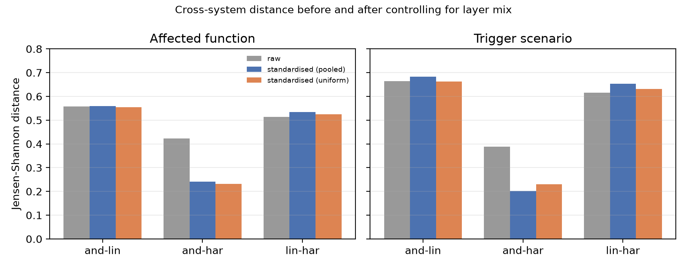

# Layer composition and cross-system defect differences

**Wen Ruibao (1240016315) · CS340 replication of arXiv:2608.20643v1 · 2026-11-26**

## 1. Question

The replication compares Android, Linux and HarmonyOS on 500 released defects
each and reports that defect distributions differ across systems.  The three
samples are not drawn from comparable layer populations: 71.8 % of the HarmonyOS
defects are in the kernel layer, against 15.8 % for Linux and 6.0 % for Android,
while Linux is dominated by application-layer defects (54.2 %) and Android by
system-service defects (38.8 %).  This report asks how much of the reported
cross-system difference is explained by that composition, and how much remains
once the layer mix is held constant.

## 2. Method

* **Data.**  The group's pinned snapshot of the authors' released records (1,500
  defects; `../data/`, hashed in `PROVENANCE.json`).  No re-labelling.
* **Support rule.**  A layer is compared only if it has at least 10 defects in
  all three systems.  Five layers qualify (Kernel, SystemLib, Framework,
  SystemService, Application); `RuntimeVM` (2 / 1 / 44) is reported in the
  composition table and excluded from inference.
* **Within-layer comparison.**  Affected-function and trigger-scenario
  distributions inside each shared layer, with the layer sample size.
* **Standardisation.**  `P_std(c) = Σ_l w_l · P(c | l)`, under two weight sets:
  *pooled* (each layer's share of all 1,500 defects: Kernel 0.322, SystemLib
  0.158, Framework 0.084, SystemService 0.175, Application 0.261) and *uniform*
  (0.200 each).
* **Distance.**  Jensen–Shannon distance (base 2; 0 = identical, 1 = disjoint
  support), for raw marginals, standardised marginals and the weighted average of
  within-layer distances.  "Explained" is `(raw − standardised) / raw`.

## 3. Layer composition

| Layer | Android n (%) | Linux n (%) | HarmonyOS n (%) | Pooled share |
| --- | ---: | ---: | ---: | ---: |
| Kernel | 30 (6.0) | 79 (15.8) | 359 (71.8) | 31.2 % |
| SystemLib | 101 (20.2) | 94 (18.8) | 34 (6.8) | 15.3 % |
| RuntimeVM | 2 (0.4) | 1 (0.2) | 44 (8.8) | 3.1 % |
| Framework | 90 (18.0) | 18 (3.6) | 14 (2.8) | 8.1 % |
| SystemService | 194 (38.8) | 37 (7.4) | 24 (4.8) | 17.0 % |
| Application | 83 (16.6) | 271 (54.2) | 25 (5.0) | 25.3 % |



## 4. Distances before and after the adjustment

| Dimension | Pair | Raw | Standardised (pooled) | Standardised (uniform) | Within-layer | Explained |
| --- | --- | ---: | ---: | ---: | ---: | ---: |
| Function | Android–Linux | 0.557 | 0.559 | 0.554 | 0.654 | −0.2 % |
| Function | Android–HarmonyOS | 0.422 | **0.241** | 0.232 | 0.441 | **+43.0 %** |
| Function | Linux–HarmonyOS | 0.513 | 0.534 | 0.526 | 0.636 | −4.1 % |
| Trigger | Android–Linux | 0.665 | 0.682 | 0.663 | 0.743 | −2.7 % |
| Trigger | Android–HarmonyOS | 0.388 | **0.203** | 0.230 | 0.368 | **+47.8 %** |
| Trigger | Linux–HarmonyOS | 0.615 | 0.653 | 0.631 | 0.723 | −6.1 % |



The pooled and uniform weights agree within ±3 percentage points, so the result
does not depend on the weighting choice.

## 5. What the numbers show

1. **Composition explains about half of the Android–HarmonyOS gap, and none of
   the Linux gaps.**  Standardising cuts Android–HarmonyOS by 43 % (function)
   and 48 % (trigger), while the two Linux-involving pairs stay unchanged or
   increase slightly.
2. **For the Linux pairs the raw comparison understates the difference.**  The
   layer-weighted average of within-layer distances is larger than the raw
   distance (function: 0.654 vs 0.557 for Android–Linux; 0.636 vs 0.513 for
   Linux–HarmonyOS) — a Simpson-type effect in which the layer mix masks
   differences present inside every shared layer.
3. **Inside the layers, Linux is the outlier.**  Kernel trigger scenario:
   Android–HarmonyOS 0.179, Linux–HarmonyOS 0.810, Android–Linux 0.866;
   SystemLib trigger scenario: 0.240 against 0.624 and 0.698.

## 6. Interpretation

The conclusion that the three systems behave differently survives the control:
after adjustment every pair remains far apart (0.203–0.682) and no pair becomes
similar.  What does not survive is treating the size or ordering of the pairwise
differences as a pure property of the systems: for Android–HarmonyOS a large part
of the gap is composition, and for the Linux pairs the reported gap is
conservative.  The paper reports marginal distributions and joint tables without
controlling for the layer mix; this analysis shows the control matters, in
opposite directions for different pairs.

## 7. Limitations

* Labels are the authors'; the analysis cannot test their reliability.
* Several within-layer cells are small (14–37 defects on one side) and their
  distances are indicative.
* `RuntimeVM` is excluded at the 10-defect threshold.
* Jensen–Shannon is dominated by the largest categories and is a distribution
  distance, not a causal test.

## 8. Reproducibility

```bash
python scripts/layer_analysis.py          # tables and figures
python scripts/run_layer_triplicate.py    # three runs, hash equality
python -m unittest discover -s tests      # 12 unit tests
```

Three runs produce byte-identical outputs; `results/determinism.json` records
the hashes and the run durations.  The analysis is deterministic, so the
standard deviation of the reported values is 0.00 by construction.
