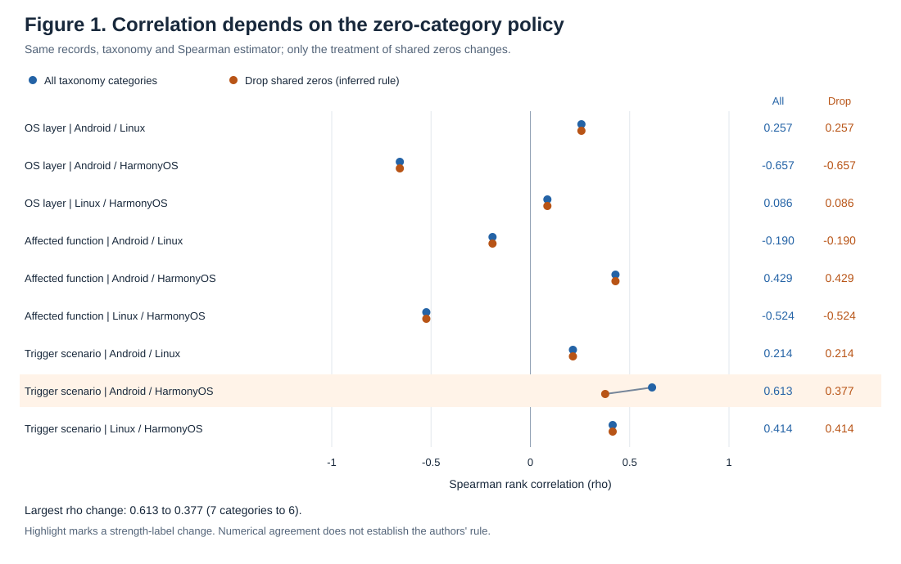
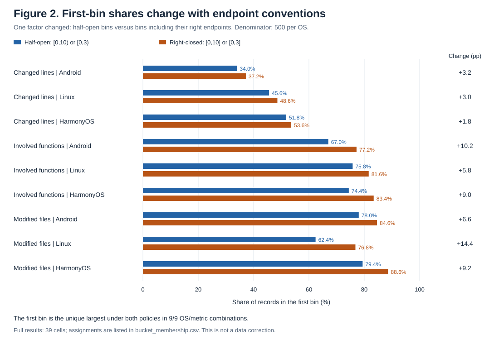

# Preprocessing Sensitivity and Dataset Consistency

Prepared for 1240009531 吴彦阳 (Wu Yanyang), CS340 group replication.

## Question and scope

Do unspecified preprocessing conventions affect the reproduced numbers and interpretations when the published defect records stay fixed?
This contribution complements the existing baseline, sample-size, severity, metric and bootstrap experiments. It does not re-collect defects or validate all author-provided labels.

## Setup and controlled contrasts

Starting group commit: `91697f2eb9ca51105f8c976d266081b9daa1e7be`. Inputs are the existing 1,500 labelled records and the group's transcribed Figures 2-4 references; SHA-256 hashes and actual environment are recorded in `logs/run1.json`.
The implementation is standard-library Python and imports no teammate analysis module. Taxonomy order and reference schemas are attributed to the baseline.

Experiment A changes only whether categories zero in both OS profiles are retained. It computes nine Figure 4(a-c) coefficients with average ranks for ties. Severity and repaired code elements are not silently added to the vectors. Figure 4(d) is excluded because its construction remains unspecified.

Experiment B changes only bin endpoint inclusion: [0,c1), [c1,c2), ... versus [0,c1], (c1,c2], ... . The last bin is explicitly unbounded. The source figure's finite tail labels are stored separately and are not treated as known finite upper bounds for censored counts.
Records, denominators, labels and metrics remain fixed. Zero-valued counts are retained; they are not silently interpreted as missing. A lower-bound value such as 20+ is assigned exactly only when every possible value is in the same bin. Ambiguous baseline membership blocks the analysis; ambiguous alternative membership is propagated as per-cell lower and upper bounds, not imputed.

## Results: zero-category policy

| Dimension | OS pair | Paper | All categories (mean ± SD) | Drop shared zeros (mean ± SD) | Categories all/drop |
|---|---|---:|---:|---:|---:|
| OS layer | Android / Linux | 0.26 | 0.257 ± 0.000 | 0.257 ± 0.000 | 6/6 |
| OS layer | Android / HarmonyOS | -0.66 | -0.657 ± 0.000 | -0.657 ± 0.000 | 6/6 |
| OS layer | Linux / HarmonyOS | 0.09 | 0.086 ± 0.000 | 0.086 ± 0.000 | 6/6 |
| Affected function | Android / Linux | -0.19 | -0.190 ± 0.000 | -0.190 ± 0.000 | 8/8 |
| Affected function | Android / HarmonyOS | 0.43 | 0.429 ± 0.000 | 0.429 ± 0.000 | 8/8 |
| Affected function | Linux / HarmonyOS | -0.52 | -0.524 ± 0.000 | -0.524 ± 0.000 | 8/8 |
| Trigger scenario | Android / Linux | 0.21 | 0.214 ± 0.000 | 0.214 ± 0.000 | 7/7 |
| Trigger scenario | Android / HarmonyOS | 0.38 | 0.613 ± 0.000 | 0.377 ± 0.000 | 7/6 |
| Trigger scenario | Linux / HarmonyOS | 0.41 | 0.414 ± 0.000 | 0.414 ± 0.000 | 7/7 |

All-category estimates match 8/9 printed coefficients after rounding; the inferred filter matches 9/9. 1 of nine coefficients changes the paper's absolute-rho strength category.
The largest rho change is Trigger scenario for Android / HarmonyOS: 0.612637 (strong) to 0.376851 (weak_or_none), using 7 versus 6 categories. This establishes policy sensitivity, not the authors' actual unpublished preprocessing rule.

## Results: bin endpoints

| Metric | OS | Half-open first-bin % (mean ± SD) | Right-closed first-bin % (mean ± SD) | Delta (pp) |
|---|---|---:|---:|---:|
| lines | Android | 34.00 ± 0.00 | 37.20 ± 0.00 | +3.20 |
| lines | Linux | 45.60 ± 0.00 | 48.60 ± 0.00 | +3.00 |
| lines | HarmonyOS | 51.80 ± 0.00 | 53.60 ± 0.00 | +1.80 |
| functions | Android | 67.00 ± 0.00 | 77.20 ± 0.00 | +10.20 |
| functions | Linux | 75.80 ± 0.00 | 81.60 ± 0.00 | +5.80 |
| functions | HarmonyOS | 74.40 ± 0.00 | 83.40 ± 0.00 | +9.00 |
| files | Android | 78.00 ± 0.00 | 84.60 ± 0.00 | +6.60 |
| files | Linux | 62.40 ± 0.00 | 76.80 ± 0.00 | +14.40 |
| files | HarmonyOS | 79.40 ± 0.00 | 88.60 ± 0.00 | +9.20 |

The half-open reconstruction matches 39/39 printed histogram cells. The largest cell change is 14.40 percentage points (Linux files, bucket 0 (zero-based)). The set of modal bins is unchanged in 9/9 OS/metric combinations.
Alternative-policy ambiguous cells: HarmonyOS functions (5,10]: [5.4%,6%]; HarmonyOS functions (10,inf): [1.8%,2.4%]. These are identification bounds, not confidence intervals; their extremes are linked by conservation and cannot be selected independently. All first-bin shares in the figure are exactly identified.
Thus, exact percentages are endpoint-sensitive, while the narrower descriptive statement that the first bin is most frequent survives these two policies. Most frequent does not necessarily mean a majority. Repairs above 500 changed lines were filtered by the paper, so this does not establish the distribution of all OS repairs.

## Dataset audit

The audit found 0 blocking errors, 4 warning(s), and 214 informational flags. Warning/info flags do not imply that labels are incorrect.
- linux defect 2044216: total changed lines is 349; 331 deletions + 28 additions = 359; verify measurement definition, do not auto-correct. An aggregate histogram match does not establish record-level arithmetic consistency.

Zero involved-function values and shared full Patch fields are reported as context, not automatically repaired or deduplicated. A shared field is not proof of duplicate defects. The audit did not download or relabel all source patches.

## Repeated runs and traceability

3 separate Python processes generated 135 scalar metrics/bounds per run (18 correlations, 39 baseline percentages and 78 alternative lower/upper percentages). `runs/runN_metrics.csv` contains the actual values; `run_statistics.csv` contains their means and sample standard deviations. All numeric metrics have SD=0. This measures execution repeatability only, not sampling error, annotation error or population uncertainty.
`paper_vs_ours.csv` contains 57 comparisons with paper values, every actual run, mean, sample SD, signed/absolute/relative gaps, and the candidate preprocessing setting. Alternative endpoint bounds remain in `binning_comparison.csv` because they refer to different intervals, rather than an identical-setting error test. Repeat-run SDs are not uncertainty intervals.
`determinism.json` compares every scientific output hash across runs, excluding environment/time metadata. `bucket_membership.csv` traces all 4,500 metric assignments to OS and Bug ID; `boundary_records.csv` isolates moved or ambiguously assigned records; `correlation_vectors.csv` preserves the exact category-count inputs.
Percentage gaps are in percentage points. Rho gaps are absolute coefficient differences. Relative gaps use abs(ours-paper)/abs(paper), stored as ratios; zero paper values use NA, and near-zero rho makes relative gaps unstable. The alternative endpoint policy changes the interval definition, so its difference is a sensitivity contrast, not an error against an identical setting.

## Verdicts and limits

| Group claim addressed | Verdict within this module | Evidence and boundary |
|---|---|---|
| C2: selected repairs concentrate in smaller bins (Figures 2-3) | Partially supported | 39/39 printed shares agree under an inferred convention; 9/9 modal-bin sets are stable. Precise percentages and zero/censored-value interpretation depend on definitions. |
| C3: similarity depends on dimension (Figure 4) | Partially supported | 9/9 marginal values agree under an inferred filter; strength-label changes: 1. Overall panel d is excluded and remains unresolved. |
| C1: defect composition (Table II) | Not evaluated here | Reuse the attributed group's baseline evidence; this audit does not supply a new label-validity test. |

- Numeric aggregation: 39/39 histogram cells agree under the group's inferred half-open convention; 9/9 marginal correlations agree under its inferred zero filter.
- Robustness: correlation strength-label changes under zero handling: 1; stable modal-bin sets: 9/9.
- Overall paper conclusions: only partially addressed. Neither numerical agreement nor these sensitivity checks independently validates the labels, selection process, causal maturity explanations or all-system generalization.
- Fixed descriptive taxonomy: each rho is over only 6-8 categories. No new significance test or population confidence claim is made.

## Attribution, contribution and AI usage

Existing labelled data, paper transcriptions and taxonomy conventions come from the group baseline, credited in ../docs/METHODS.md and ../docs/MEMBER_CONTRIBUTION.md. This module adds its own audit, controlled contrasts, record-level evidence, repeated-run summaries and charts. Existing teammates' experiments remain attributed to them.
AI assistance was used for planning, implementation, tests and drafting. The named student must inspect and understand the contribution before submission; this report does not claim that such review or manual relabelling has already occurred.

## References

1. H. Zuo, J. Li, J. Jiang. Toward Understanding Operating System Defects. arXiv:2608.20643v1, 2026. https://arxiv.org/html/2608.20643v1 (III-A, III-C, IV-A5 and IV-C).
2. Author-released dashboard: https://zuohongyao.github.io/ . The baseline source manifest pins the snapshot.
3. CS340 group baseline: https://github.com/Lx-1-2-3-4/cs340-os-defects-replication/tree/91697f2eb9ca51105f8c976d266081b9daa1e7be .
4. CS340 Research Paper Replication, Academic Year 2026-2027, supplied course instructions. This is a member analysis supplement, not the complete group Final Report.
